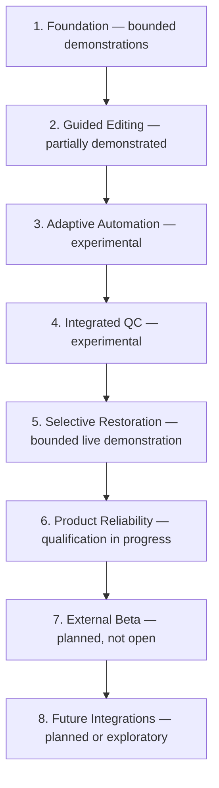
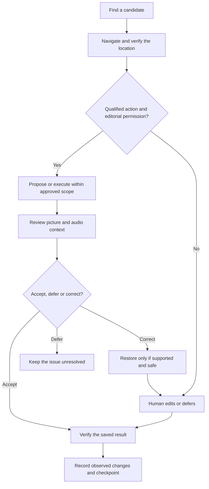

# Project Relay — Product and Engineering Roadmap

**Pre-alpha · Development codename · Updated October 15, 2026**

**Vision:** Reduce repetitive video-editing work while keeping the editor in
control of meaning, pacing and the final result.

This is a milestone roadmap, not a release schedule or an availability promise.
Workstreams overlap. A bounded demonstration does not complete a whole phase.

## Milestone map

| Phase | Current position | Evidence required to advance |
| --- | --- | --- |
| **1. Foundation** | **Demonstrated in bounded workflows.** Media analysis, native project inspection, source mapping and saved-change comparison support current experiments. | Broader supported media/project structures, independently checked boundaries and source coverage, with explicit handling of unsupported cases. |
| **2. Guided Editing** | **Partially demonstrated.** One live manual handoff/capture, a V2 desktop workspace and focused session tests. Two later shared-navigation checks passed. | Repeated live navigate → handoff → save → capture cycles; reliable pause/resume, exact current-state navigation and measured latency across representative projects. |
| **3. Adaptive Automation** | **Experimental, with bounded authorized execution demonstrated.** Eleven automatic edits and one later reviewed edit completed in separate verified continuation work. | Tested rules derived from approved examples, positive/negative and held-out cases, explicit editorial authority, and no duplicate changes. General audio/artistic choices remain blocked. |
| **4. Integrated Quality Control** | **Experimental.** Prioritized context/review queue and isolated unapproved proposals prepared. | Consecutive live playback, approve/defer/correct/save/resume cycles; unrelated work preserved; rendered picture and audio checked. This is required for the eventual 0.1 experience. |
| **5. Selective Restoration** | **Bounded live demonstration.** An earlier isolated edit was restored while ten later edits and 37 saved fade settings remained intact. | Complete human correction-and-resume qualification, more supported edit types, dependency/conflict handling and preservation of later work. Several inverse scenarios remain gated. |
| **6. Product Reliability** | **Limited checkpoint/recovery foundations demonstrated; product work remains.** | Performance, verified backups, crash/interrupted-save tests, understandable history, installation, accessibility and usability testing. No guaranteed recovery claim. |
| **7. External Beta** | **Planned; not open.** No external media intake or production pilot is authorized. | Supported-workflow assessment, permission/privacy/retention process, isolated tests, qualified recovery, actionable failure reports and a useful measured workflow. |
| **8. Future Integrations** | **Planned or exploratory.** Filmora is the initial adapter target. | Separate implementation and qualification for additional editors; feasibility work for possible native processing capabilities. |

## The intended editing and QC flow

*Concept diagram: the full loop is not yet qualified. An unsupported restoration
must remain blocked; it cannot silently become a whole-project rollback.*

## Evidence behind the current positions

- Earlier saved-change work identified removed picture/audio, retained detached
  audio and saved fades. One blind comparison found eight picture removals,
  eight audio removals, four retained audio clips and three positive saved fade-outs.
- The initial guided pilot demonstrated one live manual handoff and capture,
  with **27/27** focused tests recorded for that scope.
- **October 10:** V2 workspace/session work recorded **60/60** focused tests.
  Repeated sequences in that run were synthetic; no new live editing cycle ran.
- **October 13:** a bounded continuation completed eleven authorized edits,
  followed by one additional previously reviewed edit. Protected history and
  saved source coverage were checked; the entire video project was not completed.
- **October 13:** selective-restoration and Batch QC V3 work recorded **59**
  focused tests passing and the bounded live restoration described above.

These counts belong to different scopes and are not added into a combined
qualification score. Automated checks do not establish artistic quality.

## Product goals that remain in scope

- **Fast navigation and searchable detection:** a reusable local candidate index,
  filters for supported pauses, transitions, titles and recurring material,
  and measured latency and landing accuracy. No per-click AI delay is a design
  goal, not an achieved performance guarantee.
- **User-approved adaptive proposals:** record what a saved edit changed; ask
  briefly about intent only when needed. A correction does not automatically
  retrain a model or authorize another similar edit.
- **Integrated QC:** share navigation and context between editing and review,
  keep unapproved proposals distinct, and support correction without losing
  unrelated later work where the inverse is qualified.
- **Verified backups and history:** checkpoint verification, clear restore
  choices, visible storage use and explicit optional cleanup limited to
  Relay-owned temporary data. Preserve originals and accepted projects.
- **A usable application:** project creation/media import, onboarding,
  configuration, accessible controls, installation and copyright-safe demos.
- **Future editors:** DaVinci Resolve and Adobe Premiere Pro remain planned
  directions, not current support or release commitments. A native processing
  backend and possible native timeline capabilities remain exploratory.

## Before external testing

The project must qualify a useful supported workflow, recovery and clear failure
handling before accepting outside content. Permissions, private handling,
retention/deletion, test isolation and feedback arrangements must be agreed first.
See [External-testing readiness](docs/EXTERNAL_TESTING.md).

## Keep this roadmap current

Update this roadmap, [Development status](docs/DEVELOPMENT_STATUS.md) and
[Changelog](CHANGELOG.md) together after verified milestones or changed limits.
Feature ideas should record the editing problem, desired outcome, priority,
dependencies, acceptance criteria and status. Completion needs evidence of its
declared scope, not just a checked box. Do not attach private media, project files
or internal evidence to public issues.

See the [Product experience](docs/PRODUCT_EXPERIENCE.md),
[potential use cases](docs/USE_CASES.md) and [Qualification strategy](docs/QUALIFICATION_STRATEGY.md).
